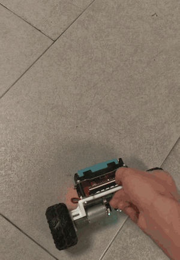
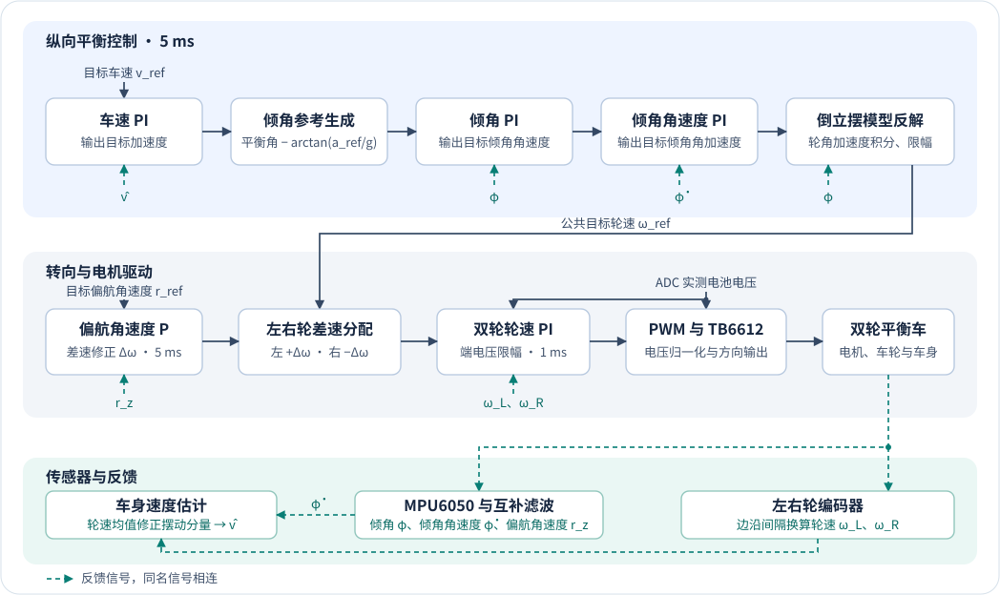
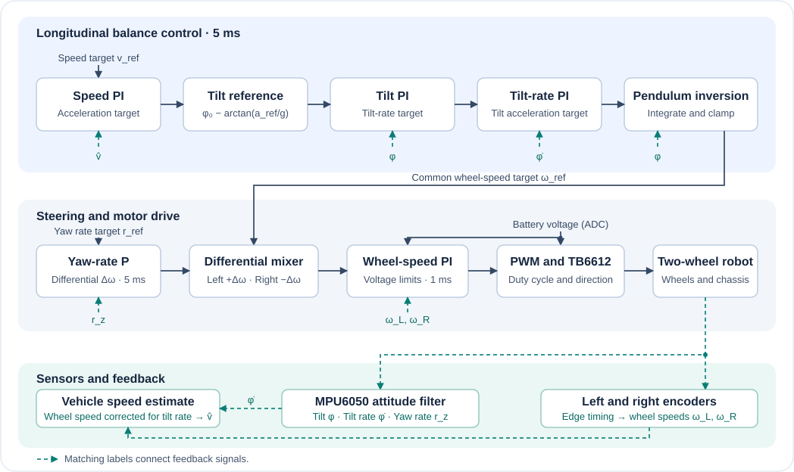

<a name="chinese"></a>

# STM32 两轮自平衡小车

[中文](#chinese) · [English](#english)

一台基于 STM32F103 的双轮倒立摆小车。车载 MPU6050 提供倾角和角速度反馈，左右轮编码器测量轮速。控制器根据车速和车身倾斜状态计算目标轮速，再由两路独立的电机 PI 控制器驱动车轮，实现站立平衡、前进、后退和差速转向。

## 成品展示



[查看完整演示视频（MP4）](show/startup.mp4)

## 控制算法



### 姿态估计与轮速测量

- **姿态估计**。MPU6050 通过 I²C 读取加速度和角速度，上电静置采样估计陀螺仪零偏。每 5 ms 用加速度计的重力方向修正陀螺仪积分，互补滤波系数为 `0.95238`。固件用 `roll` 表示绕 IMU X 轴的前后倾角，X 轴角速度用于平衡控制，Z 轴角速度用于转向控制。[姿态估计代码](Core/Src/app_mpu6050.c)
- **轮速测量**。在编码器 A 相的上升沿和下降沿触发中断，通过 A、B 相电平判断转向，并根据边沿间隔和减速比计算轮速。测速周期取最近一次边沿间隔和距最近边沿的时间两者中的较大值，车轮停止后，估算轮速会逐步趋近零。[测速代码](Core/Src/app_encoder.c) · [中断代码](Core/Src/stm32f1xx_it.c)

### 车速、平衡和转向闭环

1. **车速外环**。编码器测到的是车轮相对车身的转速。固件从平均轮速换算出的线速度中扣除车身绕轮轴摆动引入的速度分量，再用估算车速闭环。`R_w = 0.032 m` 为轮半径，`L_p = 0.062 m` 为模型中的摆长。

   $$
   \hat v = R_w\frac{\omega_L+\omega_R}{2}-(L_p+R_w)\dot\phi
   $$

   车速 PI 输出期望纵向加速度 $a_{\mathrm{ref}}$，并将其换算为相对静态平衡点的倾角修正，得到 $\phi_{\mathrm{ref}}=0.30^\circ-\arctan(a_{\mathrm{ref}}/g)$。固件把角度统一换算到弧度后计算。

2. **倾角与倾角角速度环**。倾角 PI 产生目标倾角角速度，角速度 PI 再产生期望倾角角加速度 $\ddot\phi_{\mathrm{ref}}$。用倒立摆模型反解目标轮角加速度，按实际时间间隔积分得到左右轮共用的轮速基准 $\omega_{\mathrm{ref}}$，限幅为 ±35 rad/s。

   $$
   \dot\omega_{\mathrm{ref}}=\frac{L_p\ddot\phi_{\mathrm{ref}}-g\sin\phi}{R_w\cos\phi}
   $$

3. **转向与双轮闭环**。转向支路对目标偏航角速度与 Z 轴陀螺仪反馈做比例控制，得到差速修正量 $\Delta\omega$。左右目标轮速分别为 $\omega_{\mathrm{ref}}+\Delta\omega$ 和 $\omega_{\mathrm{ref}}-\Delta\omega$。两路轮速 PI 各自根据编码器反馈计算电机端电压目标，按实测电池电压限幅，再换算成有符号 PWM 占空比，由 TB6612 控制电机转向和驱动力。

控制环复用同一套 PID 实现。当前车速、倾角、倾角角速度和双轮轮速环使用 PI，转向使用 P。积分采用梯形法，输出饱和时暂停会进一步加深饱和的积分更新。[车身控制](Core/Src/app_control.c) · [电机控制](Core/Src/app_motor.c) · [PID 实现](Core/Src/pid.c)

## 工程架构

固件采用 STM32 HAL 和裸机主循环。`main.c` 完成外设初始化，在主循环中轮询各应用模块。姿态解算和车身控制的目标周期为 **5 ms**，双轮电机控制为 **1 ms**。编码器边沿和串口收字节通过中断处理，电池电压由 TIM2 每 **10 ms** 触发 ADC 采样。[主循环](Core/Src/main.c) · [外设配置](balance_car.ioc)

| 位置 | 职责 |
| --- | --- |
| [`Core/Src/app_control.c`](Core/Src/app_control.c) | 车速、倾角、角速度串级控制，倒立摆反解与转向差速分配 |
| [`app_mpu6050.c`](Core/Src/app_mpu6050.c)、[`app_encoder.c`](Core/Src/app_encoder.c) | IMU 驱动与姿态融合，双轮编码器测速 |
| [`app_motor.c`](Core/Src/app_motor.c)、[`app_pwm.c`](Core/Src/app_pwm.c) | 左右轮速闭环、电池电压补偿、PWM 和电机方向输出 |
| [`app_bat.c`](Core/Src/app_bat.c)、[`app_button.c`](Core/Src/app_button.c)、[`app_rc.c`](Core/Src/app_rc.c) | 电池电压与 LED 指示、按键启停、串口遥控 |
| [`Core/Inc/`](Core/Inc/)、[`Drivers/`](Drivers/)、[`cmake/`](cmake/) | 固件头文件、HAL/CMSIS 和交叉编译配置 |
| [`Test/`](Test/)、[`TestData/`](TestData/)、[`tools/`](tools/) | 外设测试代码、历史实车调试数据、遥测采集工具 |
| [`Notes/`](Notes/)、[`show/`](show/) | 建模与算法笔记、控制框图和实车演示 |

默认固件在 **USART3** 上接收 `move <转向百分比> <前进百分比>` 指令，使用 `9600 8N1`，以换行符 `\n` 结束。遥测发送模块以独立源码保留，配套的上位机采集脚本和历史 CSV 可用于回顾实车调参。[串口指令解析](Core/Src/app_rc.c) · [遥测发送模块](Core/Src/app_telemetry.c) · [遥测采集脚本](tools/bluetooth_telemetry.py)

## 构建与启动

把 `arm-none-eabi-gcc` 和 Ninja 加入 `PATH`，使用 CMake 3.22 或更新版本，在仓库根目录运行：

```sh
cmake --preset Debug
cmake --build --preset Debug
```

生成的固件位于 `build/Debug/balance_car.elf`，可通过 ST-LINK 烧录。上电后先让车身静置，等待陀螺仪校准完成。扶车接近直立后单击用户按键使能电机，再松手让小车自行平衡；再次单击关闭电机驱动。

## 设计笔记

- [倒立摆动力学建模](Notes/倒立摆建模.pdf)
- [MPU6050 姿态估计与互补滤波](Notes/Attitude%20Estimation%20Algorithm.pdf)
- [速度控制与车身速度反馈推导](Notes/Speed%20Controller.pdf)

---

<a name="english"></a>

# STM32 Two-Wheel Self-Balancing Robot

[中文](#chinese) · [English](#english)

This two-wheel inverted-pendulum robot runs on an STM32F103. An onboard MPU6050 provides tilt and angular-rate feedback, and encoders measure the speed of each wheel. The controller uses vehicle speed and tilt to compute wheel-speed targets. Two independent motor PI loops track those targets so the robot can balance, drive forward or backward, and steer by varying the wheel speeds.

## Hardware Demo


[Watch the full demo (MP4)](show/startup.mp4)

## Control Algorithm



### Attitude Estimation and Wheel-Speed Measurement

- **Attitude estimation.** The STM32 reads accelerometer and gyroscope data from the MPU6050 over I²C. At startup, it estimates gyroscope bias while the robot is stationary. Every 5 ms, a complementary filter with a coefficient of `0.95238` uses the accelerometer's gravity-based tilt estimate to correct the integrated gyro angle. The firmware calls the fore–aft tilt about the IMU X-axis `roll`. It uses the X-axis angular rate for balance and the Z-axis rate for steering. [Attitude estimation](Core/Src/app_mpu6050.c)
- **Wheel-speed measurement.** An interrupt fires on each rising and falling edge of encoder channel A. The A and B states give the direction, and the edge interval and gearbox ratio give the wheel speed. The estimator uses the larger of the last edge interval and the time elapsed since that edge, so the estimated speed decays toward zero when the wheel stops. [Wheel-speed estimation](Core/Src/app_encoder.c) · [Encoder interrupts](Core/Src/stm32f1xx_it.c)

### Speed, Balance, and Steering Loops

1. **Outer vehicle-speed loop.** The encoders measure wheel rotation relative to the chassis. The firmware converts the average wheel speed to a linear speed and subtracts the contribution from chassis rotation about the wheel axle. The speed loop uses the resulting estimate as feedback. In the model, `R_w = 0.032 m` is the wheel radius and `L_p = 0.062 m` is the pendulum length.

   $$
   \hat v = R_w\frac{\omega_L+\omega_R}{2}-(L_p+R_w)\dot\phi
   $$

   The speed PI controller outputs a desired longitudinal acceleration $a_{\mathrm{ref}}$. The firmware converts it to a tilt correction around the static balance angle, giving $\phi_{\mathrm{ref}}=0.30^\circ-\arctan(a_{\mathrm{ref}}/g)$. The calculation uses radians internally.

2. **Tilt and tilt-rate loops.** The tilt PI controller generates a tilt-rate target, and the tilt-rate PI controller outputs the desired tilt acceleration $\ddot\phi_{\mathrm{ref}}$. The firmware inverts the pendulum model to obtain the required wheel angular acceleration, then integrates it using the measured time step. The resulting common wheel-speed target $\omega_{\mathrm{ref}}$ is limited to ±35 rad/s.

   $$
   \dot\omega_{\mathrm{ref}}=\frac{L_p\ddot\phi_{\mathrm{ref}}-g\sin\phi}{R_w\cos\phi}
   $$

3. **Steering and wheel-speed loops.** A proportional controller compares the commanded yaw rate with the Z-axis gyro rate to compute a differential correction $\Delta\omega$. The left and right wheel targets are $\omega_{\mathrm{ref}}+\Delta\omega$ and $\omega_{\mathrm{ref}}-\Delta\omega$, respectively. Each wheel-speed PI loop uses encoder feedback to compute a motor terminal voltage. The firmware caps the magnitude at the measured battery voltage and converts the command to a signed PWM duty cycle for the TB6612 motor driver.

The loops share a PID implementation configured as PI for vehicle speed, tilt, tilt rate, and wheel speed, and as P for yaw rate. It uses trapezoidal integration and skips integral updates that would drive a saturated output further into saturation. [Balance controller](Core/Src/app_control.c) · [Motor controller](Core/Src/app_motor.c) · [PID implementation](Core/Src/pid.c)

## Firmware Architecture

The firmware uses STM32 HAL and a bare-metal main loop. After initializing the peripherals, `main.c` polls the application modules. Attitude estimation and chassis control are scheduled every **5 ms**, and both motor loops run on a **1 ms** schedule. Encoder edges and UART receive bytes are handled by interrupts. TIM2 triggers an ADC battery-voltage sample every **10 ms**. [Main loop](Core/Src/main.c) · [Peripheral configuration](balance_car.ioc)

| Path | Responsibility |
| --- | --- |
| [`Core/Src/app_control.c`](Core/Src/app_control.c) | Speed, tilt, and tilt-rate cascade, pendulum model inversion, and differential steering |
| [`app_mpu6050.c`](Core/Src/app_mpu6050.c), [`app_encoder.c`](Core/Src/app_encoder.c) | IMU driver, attitude fusion, and wheel-speed measurement |
| [`app_motor.c`](Core/Src/app_motor.c), [`app_pwm.c`](Core/Src/app_pwm.c) | Wheel-speed loops, battery-voltage compensation, PWM, and motor direction |
| [`app_bat.c`](Core/Src/app_bat.c), [`app_button.c`](Core/Src/app_button.c), [`app_rc.c`](Core/Src/app_rc.c) | Battery monitoring and LEDs, button-controlled motor enable, and serial remote control |
| [`Core/Inc/`](Core/Inc/), [`Drivers/`](Drivers/), [`cmake/`](cmake/) | Firmware headers, HAL/CMSIS, and cross-compilation configuration |
| [`Test/`](Test/), [`TestData/`](TestData/), [`tools/`](tools/) | Peripheral tests, recorded tuning runs, and telemetry capture tools |
| [`Notes/`](Notes/), [`show/`](show/) | Modeling and algorithm notes, control diagrams, and hardware demo |

The default firmware accepts `move <steering_percent> <forward_percent>` on **USART3** at `9600 8N1`, with each command terminated by a newline (`\n`). The repository also contains a standalone telemetry transmitter, a host-side capture script, and CSV logs from earlier tuning runs. [Command parser](Core/Src/app_rc.c) · [Telemetry transmitter](Core/Src/app_telemetry.c) · [Capture script](tools/bluetooth_telemetry.py)

## Build and Run

Add `arm-none-eabi-gcc` and Ninja to `PATH`, then run the following commands from the repository root with CMake 3.22 or later.

```sh
cmake --preset Debug
cmake --build --preset Debug
```

The build produces `build/Debug/balance_car.elf`, which can be flashed using ST-LINK. Keep the robot stationary after power-up while the gyroscope calibrates. Hold the chassis close to upright, press the user button once to enable the motors, then release the chassis. Press the button again to disable the motor driver.

## Design Notes

- [Inverted-pendulum dynamics](Notes/倒立摆建模.pdf)
- [MPU6050 attitude estimation and complementary filtering](Notes/Attitude%20Estimation%20Algorithm.pdf)
- [Speed control and vehicle-speed feedback derivation](Notes/Speed%20Controller.pdf)
